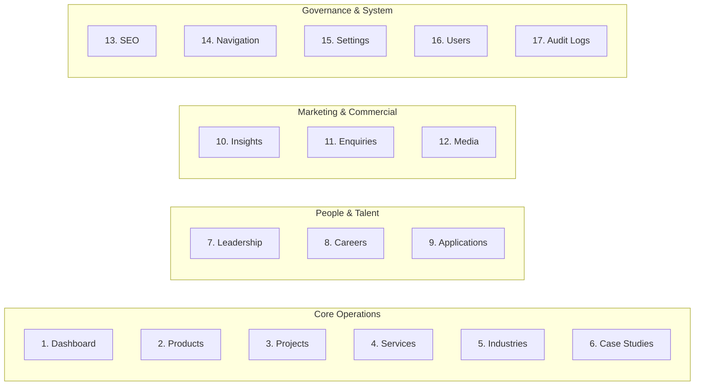

# Enterprise Administration Portal Guide — Survetra Services

## 1. Introduction & Security Principles

The **Survetra Services Admin Portal** (`/admin`) is an enterprise-grade command center providing complete operational control over the corporate website, product portfolios, talent acquisition pipelines, commercial inquiries, and technical observability.

### Portal Access Coordinates
- **Direct Login Route**: `http://localhost:3000/admin/login` (or `https://survetra.com/admin/login`)
- **Main Dashboard**: `http://localhost:3000/admin/dashboard`
- **Default Super Admin**: `admin@survetra.com`
- **Initial Password**: Configured via `ADMIN_DEFAULT_PASSWORD` (defaults to local dev credentials; must be set securely in production)

> **IMPORTANT**: Public admin registration is strictly disabled. New administrative accounts can only be provisioned by a user with the `ROLE_SUPER_ADMIN` credential through the User Management module.

---

## 2. Role-Based Permissions & Responsibilities

| Role Identifier | Display Name | Access Scope | Operational Responsibilities |
| :--- | :--- | :--- | :--- |
| `ROLE_SUPER_ADMIN` | Super Administrator | **Full Access** (All 17 Modules) | Infrastructure configuration, security settings, user provisioning, audit inspection, and global site parameters. |
| `ROLE_CONTENT_MANAGER` | Content & Product Manager | Products, Projects, Services, Industries, Case Studies, Insights, Media, Navigation, SEO | Editorial publishing, case study writing, product capability updates, and marketing assets. |
| `ROLE_HR_MANAGER` | Talent & Recruitment Manager | Careers, Job Applications | Posting open engineering and leadership requisitions, candidate pipeline management, and resume reviews. |
| `ROLE_BUSINESS_DEVELOPMENT_MANAGER` | Business Development Manager | Enquiries, Client Projects, Dashboard Leads | Managing inbound enterprise client inquiries, qualification scoring, and proposal assignments. |

---

## 3. Detailed Walkthrough of the 17 Admin Modules

### Module 1: Executive Dashboard (`/admin/dashboard`)
- **Key Metrics Cards**: Live real-time counts pulled directly from the relational database:
  - *Total Inbound Inquiries* (with 'NEW' status pill indicator)
  - *Published Products* (Tiffzy, SocialSea, Nexus)
  - *Active Job Openings*
  - *Pending Job Applications*
  - *Published Articles & Whitepapers*
- **Recent Audit Activity**: Displays the last 5 administrative actions with timestamp, actor email, and entity affected.
- **Quick Links**: One-click shortcuts to post an article, review pending applications, or inspect leads.

### Module 2: Products Management (`/admin/products`)
- Manage Survetra's flagship product lines: **Tiffzy**, **SocialSea**, and **Survetra Nexus**.
- **Fields**: Name, slug, tagline, description, feature tags, tech stack badges, external product URL, and publication toggle.
- **Actions**: Create new product, Edit metadata, Toggle publication status (Published / Draft).

### Module 3: Projects Portfolio (`/admin/projects`)
- Showcase bespoke enterprise deliveries and client solutions.
- Record client names, completion quarters, live production URLs, and technology tags.

### Module 4: Services Management (`/admin/services`)
- Govern Survetra's 11 core technology capability categories:
  - Generative AI & LLM Systems
  - RAG Architecture & Multi-Agent Frameworks
  - Full-Stack Web & Distributed Platforms
  - Mobile Engineering (iOS & Android)
  - Cloud Infrastructure, Kubernetes & DevOps
  - FinTech, Payments & Digital Ledger Integrations
- Assign custom Lucide vector icons, dynamic slugs, and detailed capability bullet points.

### Module 5: Industries Management (`/admin/industries`)
- Configure targeted market verticals:
  - Food & Restaurant Tech
  - Financial Technology & Digital Assets
  - Social Media & Creator Economy
  - Enterprise Logistics & Supply Chain
- Define hero imagery, executive problem statements, and key ROI metrics.

### Module 6: Case Studies Management (`/admin/case-studies`)
- Document high-impact digital transformations and technical architecture blueprints.
- Manage structured sections: **Challenge**, **Engineering Solution**, and **Technical Outcomes**.
- Attach solution architecture patterns, industry classification, and technical specifications.

### Module 7: Leadership & Governance (`/admin/leadership`)
- Manage executive board and senior engineering leadership.
- Update professional biographies, corporate designations, high-resolution headshot URLs, and LinkedIn profiles.

### Module 8: Careers & Requisitions (`/admin/careers`)
- Maintain talent requisitions across Engineering, Product, Design, and AI Research.
- Set experience levels (`Junior`, `Mid-Level`, `Senior`, `Staff / Lead`, `Principal`), employment type (`Full-time`, `Contract`), and remote/hybrid work policies.
- Automatically synchronizes with the public `/careers` and `/careers/[slug]` job portals.

### Module 9: Candidate Applications (`/admin/applications`)
- Real-time intake queue for resumes submitted through the public career portal.
- Inspect applicant names, contact emails, phone numbers, cover letters, and one-click resume download links.
- Move candidates through hiring stages: `PENDING` ➔ `REVIEWED` ➔ `INTERVIEWING` ➔ `OFFER` ➔ `REJECTED`.

### Module 10: Insights & Technical Articles (`/admin/insights`)
- Editorial publishing hub for whitepapers, engineering architecture blogs, and market research.
- Rich metadata controls: category, read-time calculation, author attribution, cover image, and publication date.

### Module 11: Business Enquiries & Leads (`/admin/enquiries`)
- Enterprise inbox capturing proposals submitted via `/contact`.
- Triage incoming requests by urgency and category.
- Update lead status: `NEW` ➔ `IN_PROGRESS` ➔ `PROPOSAL_SENT` ➔ `CLOSED`.

### Module 12: Media Library (`/admin/media`)
- Central digital asset store integrated with AWS S3 / object storage.
- Upload PNG, JPEG, SVG, WEBP, and PDF documents.
- Includes file size validation (max 25MB), MIME type enforcement, and one-click CDN URL copying.

### Module 13: SEO & Metadata Management (`/admin/seo`)
- Configure global and per-route meta titles, descriptions, and OpenGraph social cards.
- Manage canonical URL overrides and search engine indexing directives (`index, follow` vs `noindex`).

### Module 14: Navigation Hierarchy (`/admin/navigation`)
- Visually order the primary header navbar and footer links.
- Create multi-level dropdown flyouts for products and services without modifying frontend templates.

### Module 15: Website & System Settings (`/admin/settings`)
- Global configuration parameters:
  - Official corporate entity name: **Survetra Services Private Limited**
  - Primary contact: `sureshbabu@survetra.com`, Phone: `+91 77776 4632`
  - Global corporate headquarters address
  - Live system status display (e.g., `All Systems Operational`)
  - Maintenance mode toggle

### Module 16: User & RBAC Management (`/admin/users`)
- Super Administrator workspace to invite, manage, and deactivate administrative staff.
- Assign granular roles (`SUPER_ADMIN`, `CONTENT_MANAGER`, `HR_MANAGER`, `BUSINESS_DEVELOPMENT_MANAGER`).
- Enforces strict password complexity rules and immediate session revocation upon deactivation.

### Module 17: Compliance & Audit Logs (`/admin/audit-logs`)
- Tamper-evident, immutable activity ledger.
- Captures every administrative write operation:
  - `TIMESTAMP`: Microsecond UTC record
  - `ACTOR`: Email of authenticated administrator
  - `ACTION`: E.g., `CREATE_PRODUCT`, `UPDATE_SERVICE`, `DELETE_USER`
  - `CLIENT IP`: Remote network address
  - `PAYLOAD`: Full JSON payload before and after modification

---

## 4. Administrative Session Hygiene & Best Practices

1. **Session Expiry**: Admin JWT tokens expire automatically after 24 hours. The portal automatically redirects to `/admin/login` upon token expiration.
2. **Device Sharing**: Always click **"Sign Out"** in the sidebar before leaving an administrative workstation.
3. **Password Security**: Use passwords with a minimum of 12 characters, combining upper and lowercase letters, numbers, and symbols.
4. **Audit Trail Accountability**: All administrative operations are irreversibly tied to your authenticated identity.

