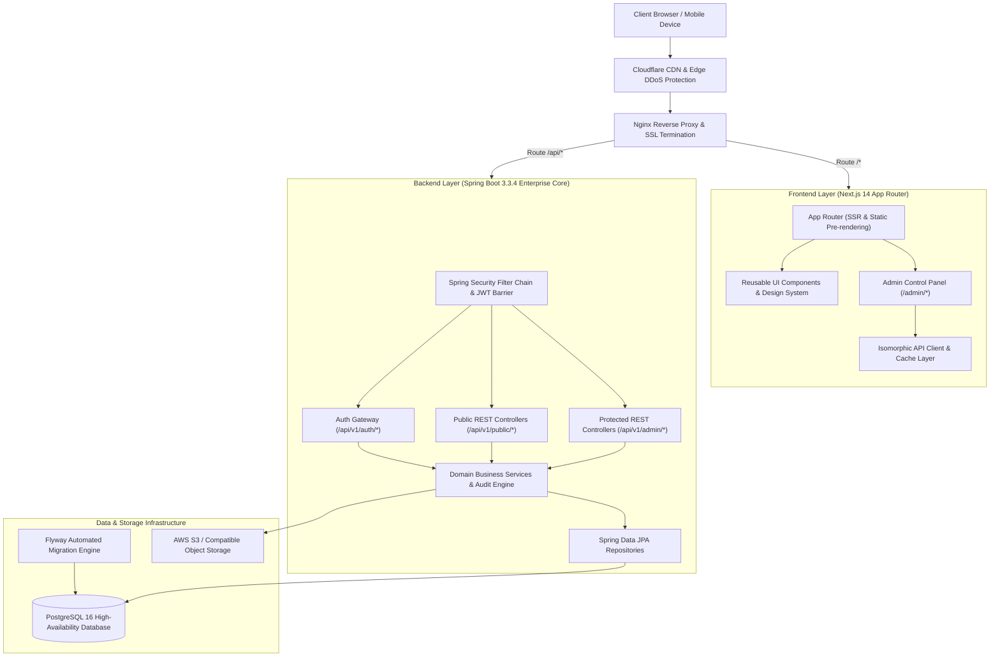
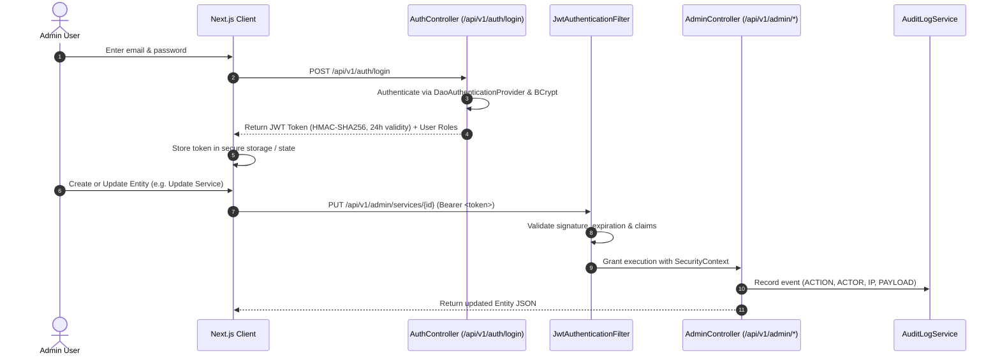

# System Architecture Specification — Survetra Services

## 1. Architectural Philosophy & Overview

The Survetra Services web ecosystem is engineered as an enterprise-grade, distributed corporate platform. It decouples the client-facing digital experience from core business logic, administrative persistence, and operational telemetry through a clean, multi-tiered micro-service architecture.



---

## 2. Frontend Architectural Structure

The user interface is powered by **Next.js 14** leveraging the **App Router** paradigm, written in 100% strict TypeScript.

### 2.1 Component & Directory Topology
```
frontend/
├── app/
│   ├── layout.tsx              # Root HTML shell, fonts, global analytics, LayoutShell
│   ├── page.tsx                # Corporate Homepage (Hero, Stats, Capabilities, Products)
│   ├── globals.css             # Tailwind design tokens, custom glassmorphism, scrollbars
│   ├── sitemap.ts              # Automated XML sitemap generation
│   ├── robots.ts               # Web crawler directive definitions
│   │
│   ├── (public pages)
│   │   ├── about/              # Company mission, core values, history, global scale
│   │   ├── leadership/         # Executive roster, biographies, advisory board
│   │   ├── services/           # Service catalog + dynamic [slug] detail pages
│   │   ├── products/           # Product portfolio (Tiffzy, SocialSea, Nexus) + [slug]
│   │   ├── industries/         # Vertical sector solutions
│   │   ├── case-studies/       # Enterprise success stories + dynamic [slug] breakdowns
│   │   ├── innovation/         # R&D lab, patents, open-source engineering
│   │   ├── insights/           # Thought leadership, research papers, tech blogs + [slug]
│   │   ├── careers/            # Open roles catalog + dynamic job detail [slug]
│   │   ├── contact/            # Interactive enterprise inquiry form with validation
│   │   ├── privacy-policy/     # GDPR / CCPA compliant privacy disclosures
│   │   └── terms/              # Master service terms and corporate conditions
│   │
│   └── admin/                  # Enterprise Administration Portal
│       ├── layout.tsx          # Secured Admin layout, sidebar navigation, user badge
│       ├── login/              # Administrative authentication portal
│       ├── dashboard/          # Real-time KPIs, submission queues, system telemetry
│       ├── products/           # Product lifecycle management
│       ├── projects/           # Client project delivery tracker
│       ├── services/           # Capability portfolio management
│       ├── industries/         # Vertical market management
│       ├── case-studies/       # Client case study management
│       ├── leadership/         # Executive roster management
│       ├── careers/            # Job requisition management
│       ├── applications/       # Candidate pipeline & resume review
│       ├── insights/           # Editorial blog & article publishing
│       ├── enquiries/          # Inbound enterprise leads management
│       ├── media/              # Digital asset manager & uploader
│       ├── seo/                # Meta tags and OpenGraph configuration
│       ├── navigation/         # Header and footer navigation hierarchy
│       ├── settings/           # Global site variables, SLAs, corporate addresses
│       ├── users/              # RBAC user management (Super Admin, HR, Content, BizDev)
│       └── audit-logs/         # Immutable audit ledger of administrative events
│
├── components/                 # Atomic and composite UI components
│   ├── BrandLogo.tsx           # Scalable vector brand geometry with custom gradients
│   ├── Navbar.tsx              # Glassmorphic responsive header with multi-tiered flyouts
│   ├── Footer.tsx              # Enterprise 5-column footer with live SLA telemetry
│   ├── HeroVisual.tsx          # Canvas-inspired abstract geometric orbit visualization
│   ├── ContactForm.tsx         # Enterprise contact form with client/server validation
│   ├── CareerApplicationForm.tsx # Resume upload and candidate intake form
│   └── LayoutShell.tsx         # Route-aware wrapper to suppress public chrome on /admin
│
└── lib/                        # Shared utility layers
    ├── api.ts                  # Typed REST API client with intelligent cache fallbacks
    ├── adminAuth.ts            # Client-side session, JWT token handling, and role guards
    └── data.ts                 # Master canonical seed data and comprehensive type schemas
```

### 2.2 Design System & Visual Grammar
- **Color Architecture**:
  - `Midnight Dark`: `#10121C` (Primary background, deep enterprise contrast)
  - `Card Slate`: `#161926` / `#1D2132` (Elevated card planes)
  - `Brand Orange`: `#F28B32` (Primary brand accent, interactive elements)
  - `Brand Violet`: `#7655E8` (Secondary brand accent, technical gradients)
  - `Brand Light`: `#F5F6FA` (Neutral high-contrast surfaces)
- **Typography**: Clean humanist sans-serif with negative letter-spacing for large editorial headlines (`tracking-tight`) paired with high-legibility body prose.
- **Micro-Interactions**: Subtle Framer Motion physics, glassmorphic backdrop filters (`backdrop-blur-md`), and gradient hover glows without visual noise.

---

## 3. Backend Architectural Structure

The backend is developed with **Java 17 LTS** and **Spring Boot 3.3.4**, adopting clean Domain-Driven Design (DDD) layered patterns.

```
backend/src/main/java/com/survetra/
├── config/
│   ├── SecurityConfig.java       # Spring Security 6 filter chain, CORS, CSRF, BCrypt
│   ├── JwtAuthenticationFilter.java # Stateless Bearer token verification filter
│   └── OpenApiConfig.java        # Swagger 3.0 / OpenAPI spec definitions with BearerAuth
│
├── controller/
│   ├── AuthController.java       # JWT issuance (/login) and identity introspection (/me)
│   ├── PublicController.java     # Open, high-throughput endpoints for corporate pages
│   └── AdminController.java      # RBAC-gated endpoints for the 17 administrative modules
│
├── model/                        # Normalized JPA / Hibernate Entities
│   ├── BaseEntity.java           # Auditable base class (UUID ID, created_at, updated_at)
│   ├── Role.java                 # Security role definition (SUPER_ADMIN, HR, CONTENT, etc.)
│   ├── User.java                 # Administrative user entity with encrypted credentials
│   ├── Product.java              # Tiffzy, SocialSea, Nexus, and future product lines
│   ├── Project.java              # Custom software and digital engineering deliverables
│   ├── ServiceEntity.java        # Technology consulting & development offerings
│   ├── Industry.java             # Enterprise target verticals
│   ├── CaseStudy.java            # Detailed quantitative transformation narratives
│   ├── TeamMember.java           # Executive board and engineering leadership
│   ├── JobOpening.java           # Active job requisitions with department and requirements
│   ├── JobApplication.java       # Candidate submissions with resume attachment URI
│   ├── Article.java              # Thought leadership and engineering whitepapers
│   ├── Enquiry.java              # Inbound business proposals and contact messages
│   ├── MediaAsset.java           # Uploaded binary file metadata and S3 storage keys
│   ├── SiteSetting.java          # Key-value site configuration and uptime metrics
│   ├── NavigationItem.java       # Dynamically managed menu hierarchy
│   └── AuditLog.java             # Immutable audit trail with actor, action, and payload
│
├── repository/                   # Spring Data JPA interfaces with type-safe query methods
│   └── (16 Repository interfaces extending JpaRepository<Entity, UUID>)
│
├── service/                      # Core business services
│   ├── AuditLogService.java      # Asynchronous audit event recorder
│   ├── ContentService.java       # Unified content aggregator with live statistics
│   ├── CustomUserDetailsService.java # Spring Security user details provider
│   └── DataInitializerService.java   # First-boot data seeder and Super Admin provisioner
│
├── dto/                          # Clean Data Transfer Objects
│   ├── AuthDtos.java             # LoginRequest, JwtResponse, UserProfileDto
│   └── FormDtos.java             # ContactFormDto, JobApplicationFormDto, ApiResponse
│
├── exception/
│   └── GlobalExceptionHandler.java # Centralized REST error handler with standardized JSON
│
└── util/
    └── JwtUtils.java             # HMAC-SHA256 signature generator and validator
```

---

## 4. Security & Role-Based Access Control (RBAC)

The security subsystem enforces zero-trust boundaries across all administrative routes.



### Role Matrix:
| Role | Capabilities | Target User Group |
| :--- | :--- | :--- |
| `ROLE_SUPER_ADMIN` | Unrestricted read/write access to all 17 modules, including User Management and Security Settings. | CTO, VP of Infrastructure |
| `ROLE_CONTENT_MANAGER` | Read/write access to Products, Projects, Services, Industries, Case Studies, Insights, and Media. | Marketing & Product Teams |
| `ROLE_HR_MANAGER` | Read/write access to Job Openings and Job Applications. | Talent Acquisition Team |
| `ROLE_BUSINESS_DEVELOPMENT_MANAGER` | Access to Inbound Enquiries, Leads, and Project proposals. | Sales & Partnerships Team |

---

## 5. Resilience, Fault Tolerance & Performance Strategy

1. **Static Pre-Rendering (SSG)**: Public marketing routes are statically compiled during build time (`generateStaticParams` for products, services, insights, and careers), guaranteeing sub-100ms response times globally.
2. **Graceful Fallback Mode**: The Next.js API client (`lib/api.ts`) contains an automated fallback mechanism: if the backend database is unreachable during network partitioning, the frontend immediately falls back to verified static data, preventing any user-visible error screens.
3. **Database Connection Pooling**: HikariCP handles enterprise connection pooling with automated healthchecks, connection leaks detection, and query timeout governance.
4. **Automated Schema Lifecycle**: Flyway manages transactional SQL migrations. Database state is version-controlled and reproducible across local development, CI/CD runners, and production clusters.

