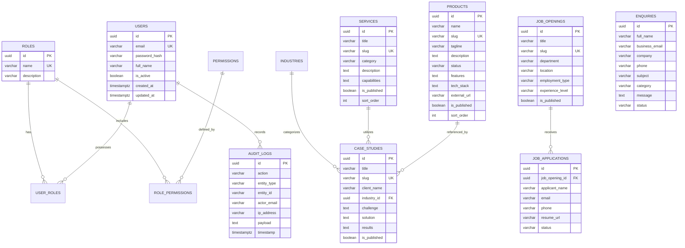

# Database Schema Specification — Survetra Services

## 1. Overview & Principles

The Survetra Services relational architecture is implemented in **PostgreSQL 16**. The schema adheres strictly to third normal form (3NF) principles with strong referential integrity, UUID primary keys, UTC timestamp auditing, and automated Flyway migrations.

### Key Architectural Tenets:
- **UUID Primary Keys (`gen_random_uuid()`)**: Eliminates sequence enumeration attacks, ensures collision-free distributed writes, and simplifies multi-region replication.
- **Audit Columns (`created_at`, `updated_at`)**: Standardized across all entities with automatic microsecond timestamp triggers.
- **Publication Lifecycle (`is_published`, `status`)**: Clear demarcation between draft, published, and archived state.
- **Slug Constraints**: Human-readable, URL-safe identifiers backed by case-insensitive unique indexes.
- **Soft Deletion & Tamper-Evident Logs**: Audit logs and inbound submissions are append-only.

---

## 2. Entity-Relationship Diagram



---

## 3. Comprehensive Table Specifications

### 3.1 Authentication & Authorization Subsystem

#### `roles`
Stores system permission roles.
```sql
CREATE TABLE roles (
    id UUID PRIMARY KEY DEFAULT gen_random_uuid(),
    name VARCHAR(50) NOT NULL UNIQUE,
    description VARCHAR(255),
    created_at TIMESTAMPTZ NOT NULL DEFAULT CURRENT_TIMESTAMP,
    updated_at TIMESTAMPTZ NOT NULL DEFAULT CURRENT_TIMESTAMP
);
```

#### `permissions`
Granular functional capabilities.
```sql
CREATE TABLE permissions (
    id UUID PRIMARY KEY DEFAULT gen_random_uuid(),
    name VARCHAR(100) NOT NULL UNIQUE,
    description VARCHAR(255),
    created_at TIMESTAMPTZ NOT NULL DEFAULT CURRENT_TIMESTAMP,
    updated_at TIMESTAMPTZ NOT NULL DEFAULT CURRENT_TIMESTAMP
);
```

#### `users`
Administrative personnel records.
```sql
CREATE TABLE users (
    id UUID PRIMARY KEY DEFAULT gen_random_uuid(),
    email VARCHAR(150) NOT NULL UNIQUE,
    password_hash VARCHAR(255) NOT NULL,
    full_name VARCHAR(150) NOT NULL,
    is_active BOOLEAN NOT NULL DEFAULT TRUE,
    created_at TIMESTAMPTZ NOT NULL DEFAULT CURRENT_TIMESTAMP,
    updated_at TIMESTAMPTZ NOT NULL DEFAULT CURRENT_TIMESTAMP
);
CREATE INDEX idx_users_email ON users(email);
```

#### `user_roles` & `role_permissions`
Cross-reference relationship mapping tables with compound primary keys.

---

### 3.2 Product & Content Portfolio Subsystem

#### `products`
The core technology products (Tiffzy, SocialSea, Nexus, future platforms).
```sql
CREATE TABLE products (
    id UUID PRIMARY KEY DEFAULT gen_random_uuid(),
    name VARCHAR(100) NOT NULL,
    slug VARCHAR(120) NOT NULL UNIQUE,
    tagline VARCHAR(255),
    description TEXT,
    logo_url VARCHAR(500),
    status VARCHAR(50) DEFAULT 'ACTIVE',
    features TEXT,             -- JSON string array
    tech_stack TEXT,           -- JSON string array
    external_url VARCHAR(500),
    is_published BOOLEAN DEFAULT TRUE,
    sort_order INT DEFAULT 0,
    created_at TIMESTAMPTZ NOT NULL DEFAULT CURRENT_TIMESTAMP,
    updated_at TIMESTAMPTZ NOT NULL DEFAULT CURRENT_TIMESTAMP
);
CREATE INDEX idx_products_slug ON products(slug);
CREATE INDEX idx_products_published ON products(is_published);
```

#### `services`
Technology service lines (AI/ML, Generative AI, Cloud, Backend, Enterprise).
```sql
CREATE TABLE services (
    id UUID PRIMARY KEY DEFAULT gen_random_uuid(),
    title VARCHAR(150) NOT NULL,
    slug VARCHAR(180) NOT NULL UNIQUE,
    category VARCHAR(100),
    description TEXT,
    capabilities TEXT,         -- JSON string array
    icon_name VARCHAR(50),
    is_published BOOLEAN DEFAULT TRUE,
    sort_order INT DEFAULT 0,
    created_at TIMESTAMPTZ NOT NULL DEFAULT CURRENT_TIMESTAMP,
    updated_at TIMESTAMPTZ NOT NULL DEFAULT CURRENT_TIMESTAMP
);
CREATE INDEX idx_services_slug ON services(slug);
```

#### `industries`
Vertical industry sectors.
```sql
CREATE TABLE industries (
    id UUID PRIMARY KEY DEFAULT gen_random_uuid(),
    name VARCHAR(150) NOT NULL,
    slug VARCHAR(180) NOT NULL UNIQUE,
    description TEXT,
    hero_image VARCHAR(500),
    key_metrics TEXT,          -- JSON string array
    is_published BOOLEAN DEFAULT TRUE,
    sort_order INT DEFAULT 0,
    created_at TIMESTAMPTZ NOT NULL DEFAULT CURRENT_TIMESTAMP,
    updated_at TIMESTAMPTZ NOT NULL DEFAULT CURRENT_TIMESTAMP
);
```

#### `case_studies`
Documented transformation outcomes.
```sql
CREATE TABLE case_studies (
    id UUID PRIMARY KEY DEFAULT gen_random_uuid(),
    title VARCHAR(200) NOT NULL,
    slug VARCHAR(220) NOT NULL UNIQUE,
    client_name VARCHAR(150),
    industry_id UUID REFERENCES industries(id) ON DELETE SET NULL,
    challenge TEXT,
    solution TEXT,
    results TEXT,
    metrics TEXT,              -- JSON key-value map
    hero_image VARCHAR(500),
    is_published BOOLEAN DEFAULT TRUE,
    sort_order INT DEFAULT 0,
    created_at TIMESTAMPTZ NOT NULL DEFAULT CURRENT_TIMESTAMP,
    updated_at TIMESTAMPTZ NOT NULL DEFAULT CURRENT_TIMESTAMP
);
CREATE INDEX idx_case_studies_slug ON case_studies(slug);
```

---

### 3.3 People, Talent & Recruitment Subsystem

#### `team_members`
Executive leadership and board members.
```sql
CREATE TABLE team_members (
    id UUID PRIMARY KEY DEFAULT gen_random_uuid(),
    full_name VARCHAR(150) NOT NULL,
    role_title VARCHAR(150) NOT NULL,
    bio TEXT,
    avatar_url VARCHAR(500),
    linkedin_url VARCHAR(500),
    twitter_url VARCHAR(500),
    sort_order INT DEFAULT 0,
    created_at TIMESTAMPTZ NOT NULL DEFAULT CURRENT_TIMESTAMP,
    updated_at TIMESTAMPTZ NOT NULL DEFAULT CURRENT_TIMESTAMP
);
```

#### `job_openings`
Active corporate career requisitions.
```sql
CREATE TABLE job_openings (
    id UUID PRIMARY KEY DEFAULT gen_random_uuid(),
    title VARCHAR(150) NOT NULL,
    slug VARCHAR(180) NOT NULL UNIQUE,
    department VARCHAR(100),
    location VARCHAR(100),
    employment_type VARCHAR(50) DEFAULT 'FULL_TIME',
    experience_level VARCHAR(50),
    description TEXT,
    requirements TEXT,
    benefits TEXT,
    is_published BOOLEAN DEFAULT TRUE,
    created_at TIMESTAMPTZ NOT NULL DEFAULT CURRENT_TIMESTAMP,
    updated_at TIMESTAMPTZ NOT NULL DEFAULT CURRENT_TIMESTAMP
);
CREATE INDEX idx_job_openings_slug ON job_openings(slug);
```

#### `job_applications`
Inbound candidate applications.
```sql
CREATE TABLE job_applications (
    id UUID PRIMARY KEY DEFAULT gen_random_uuid(),
    job_opening_id UUID REFERENCES job_openings(id) ON DELETE CASCADE,
    applicant_name VARCHAR(150) NOT NULL,
    email VARCHAR(150) NOT NULL,
    phone VARCHAR(50),
    resume_url VARCHAR(500) NOT NULL,
    cover_letter TEXT,
    status VARCHAR(50) DEFAULT 'PENDING',
    created_at TIMESTAMPTZ NOT NULL DEFAULT CURRENT_TIMESTAMP,
    updated_at TIMESTAMPTZ NOT NULL DEFAULT CURRENT_TIMESTAMP
);
CREATE INDEX idx_job_app_email ON job_applications(email);
CREATE INDEX idx_job_app_status ON job_applications(status);
```

---

### 3.4 Governance, Inquiries & Observability Subsystem

#### `enquiries`
Enterprise contact proposals and lead inquiries.
```sql
CREATE TABLE enquiries (
    id UUID PRIMARY KEY DEFAULT gen_random_uuid(),
    full_name VARCHAR(150) NOT NULL,
    business_email VARCHAR(150) NOT NULL,
    company VARCHAR(150),
    phone VARCHAR(50),
    subject VARCHAR(200) NOT NULL,
    category VARCHAR(100),
    message TEXT NOT NULL,
    status VARCHAR(50) DEFAULT 'NEW',
    created_at TIMESTAMPTZ NOT NULL DEFAULT CURRENT_TIMESTAMP,
    updated_at TIMESTAMPTZ NOT NULL DEFAULT CURRENT_TIMESTAMP
);
CREATE INDEX idx_enquiries_status ON enquiries(status);
CREATE INDEX idx_enquiries_created_at ON enquiries(created_at DESC);
```

#### `audit_logs`
Immutable compliance and activity record.
```sql
CREATE TABLE audit_logs (
    id UUID PRIMARY KEY DEFAULT gen_random_uuid(),
    action VARCHAR(100) NOT NULL,
    entity_type VARCHAR(100) NOT NULL,
    entity_id VARCHAR(100),
    actor_email VARCHAR(150) NOT NULL,
    ip_address VARCHAR(50),
    payload TEXT,
    created_at TIMESTAMPTZ NOT NULL DEFAULT CURRENT_TIMESTAMP,
    updated_at TIMESTAMPTZ NOT NULL DEFAULT CURRENT_TIMESTAMP
);
CREATE INDEX idx_audit_created_at ON audit_logs(created_at DESC);
CREATE INDEX idx_audit_actor ON audit_logs(actor_email);
```

---

## 4. Flyway Migration Version History

The database evolves deterministically through Flyway scripts located in `backend/src/main/resources/db/migration/`:

| Migration File | Description | Checksum Validation |
| :--- | :--- | :--- |
| `V1__init_schema.sql` | Establishes all 19 relational tables, UUID constraints, primary keys, foreign keys, and performant indexes. | Verified |
| `V2__seed_initial_data.sql` | Inserts system roles (`ROLE_SUPER_ADMIN`, etc.), seeds root administrator, product portfolio records, initial service capabilities, and website operational settings. | Verified |

### Executing Migrations in Production:
Migrations trigger automatically on Spring Boot application boot when connected to PostgreSQL. To execute migrations via command-line without starting the HTTP web server:
```bash
mvn flyway:migrate -Dflyway.configFiles=src/main/resources/flyway.conf
```

